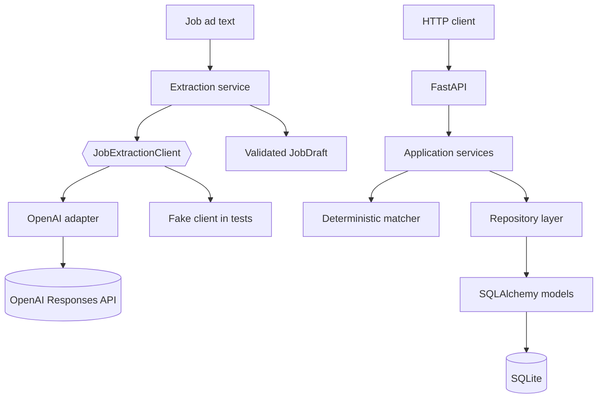

# Architecture

AI Job Assistant separates deterministic application logic, persistence, and model calls so each boundary can be tested independently.

## Design choices

- The application depends on a small model-client protocol rather than directly on a provider.
- Model output is validated with Pydantic before becoming a `JobDraft`.
- Job-ad text is treated as untrusted data, not instructions.
- Candidate matching remains deterministic and separate from LLM extraction.
- Persistence is isolated behind repository functions and versioned with Alembic.
